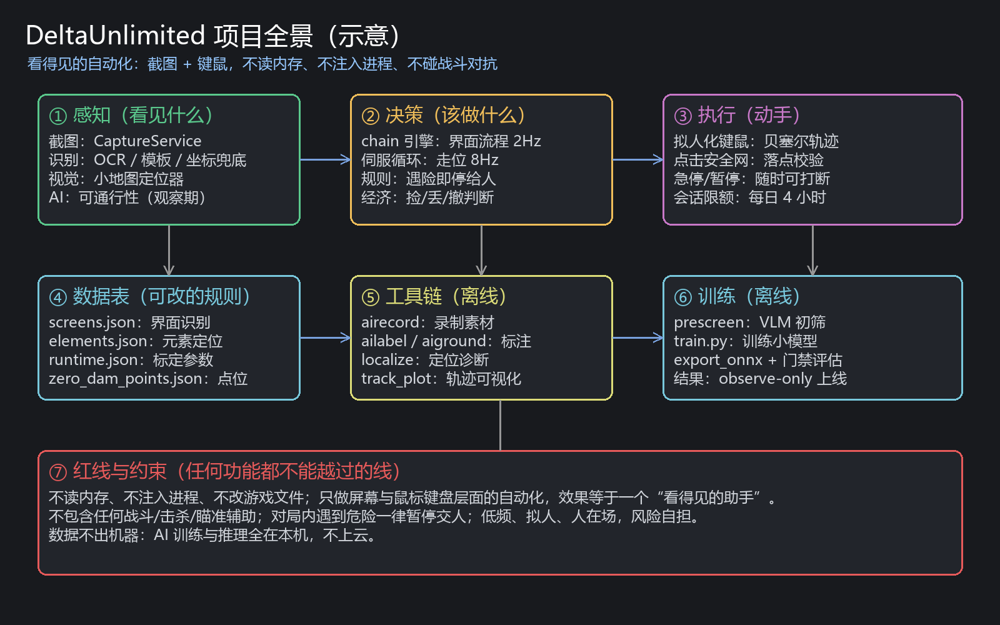

# 👋 从这里开始

> [!tip] 这是什么
> 这是 **DeltaUnlimited 项目的完整知识库**——把"为什么做、怎么做的、踩过什么坑、当时怎么想的"全部整理成一篇篇互相链接的笔记。
> 你不用记住任何细节：**忘了就回来搜**。

## 第一步：用 Obsidian 打开它

1. 下载安装 [Obsidian](https://obsidian.md)（免费，个人使用不需要付费）；
2. 打开 Obsidian → 选「**打开文件夹作为库**」（Open folder as vault）；
3. 选择这个文件夹：`D:\MeineArbeit\DeltaUnlimited\vault`；
4. 完成后你会看到左侧文件列表——点任意一篇就能读。

> [!warning] 千万不要用「导入」或「新建库」
> 一定要选「打开文件夹作为库」，否则它会复制一份空库。这个文件夹里已经准备好所有内容了。

👉 第一次用的话，先读 [[Obsidian入门]]（5 分钟学会点链接、搜索、看关系图）。

## 第二步：五条主线（按你现在想干什么挑）

| 我想知道…… | 去哪 |
|---|---|
| 这个项目到底是干什么的、现在做到哪了 | [[01 项目总览]] |
| 以前都发生过什么、按时间怎么走的 | [[02 时间线]] |
| 某个功能怎么实现的 | [[架构-总览]] |
| 为什么当初这样决定（以及推翻过什么） | [[决策-红线与边界]] |
| 踩过哪些坑、怎么修好的 | [[坑-小地图圆形vs矩形]]（入口示例，全库搜 `#踩坑`） |
| 某个数值/坐标/阈值是多少、怎么标的 | [[标定-地图坐标换算]] |
| 声音、AI、定位这些"技术名词"是什么 | [[知识点-模板匹配与NCC]] |
| 接下来要做什么 | [[路线图与待办]] |

## 第三步：怎么用这个库（三种用法，从易到难）

1. **搜**：按 `Ctrl+O` 输入关键词（比如"小地图"）→ 直接跳到笔记；
2. **点**：每篇笔记里的**蓝色双方括号**都是链接，点进去就是相关笔记（这就是知识库的核心：知识点之间互相串联，而不是一本从头读到尾的书）；
3. **看关系图**：按 `Ctrl+G` 打开关系图 → 能看到这个知识库的全貌（节点=笔记，连线=关联）。

## 这个库是谁写的、准不准？

- 内容来源：项目的 `docs/` 文档、代码注释、Git 提交记录、以及当时与 AI 的讨论结论；
- 每篇笔记末尾都有 **「出处」**，写明依据的文件/提交——你可以随时回查原文；
- 不确定的地方会标 `❓待确认`，**不要当成事实**；
- 如果发现笔记和代码不一致：**以代码和 `docs/` 为准**，并请让我更新这篇笔记。

## 我会持续维护

- 每当我完成一个阶段 / 修好一个坑 / 做了一个决定，我会同步更新这个库；
- 你也可以直接在这个库里加笔记——规则见 [[如何维护这个知识库]]，不用怕写坏，Obsidian 只是普通文本文件。

## 全景画布（可视化）

Obsidian 支持「画布」（Canvas）：在这个库里双击打开 **`项目全景.canvas`**，能看到整个项目的模块与数据流关系图（可以拖拽缩放）。

> 配图：本项目的整体关系（示意）。更完整的交互式版本在 `项目全景.canvas`。
